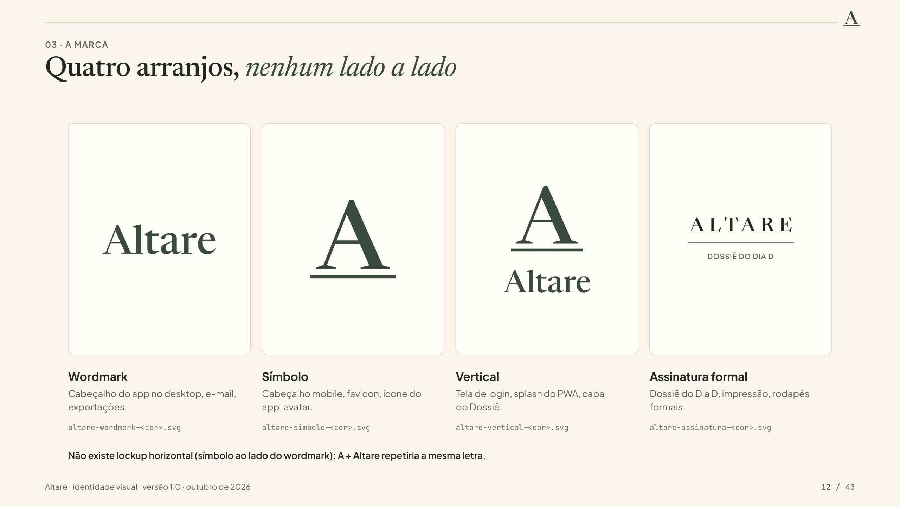

# Altare — Identidade Visual Oficial (`docs/design/identity.md`)

> **Versão:** 1.0 · **Data:** 2026-10-27
> **Status:** **Aprovado pelo usuário em 2026-10-27 (`D-025`)**, incluindo o guia completo (`D-024`). Nome em `D-023`; princípios, paleta oficial, tipografia e tom em `D-015`/`D-016`/`D-022`. O Altare **não é só para casamentos católicos** (`D-026`): a identidade é sacra e discreta, mas não confessional. Mudanças a partir daqui exigem nova decisão registrada.
>
> **Este é o documento-fonte da marca.** O Design System (`docs/design/design-system.md`) implementa o que está aqui; em caso de conflito, vale este documento, exceto pela direção de personalidade de `docs/design/visual-direction.md` (`D-015`/`D-016`), que continua sendo a base.
>
> **Guia completo da identidade (brand book, `D-024`):** [`identidade-visual/altare-identidade-visual.pdf`](./identidade-visual/altare-identidade-visual.pdf), com 43 páginas (versão navegável em [`.html`](./identidade-visual/altare-identidade-visual.html)). Logos-mestre em [`identidade-visual/fonte/`](./identidade-visual/fonte/), componentes exportados e índice em [`identidade-visual/componentes/INDEX.md`](./identidade-visual/componentes/INDEX.md).
>
> **Fonte única dos valores:** [`identidade-visual/tokens.json`](./identidade-visual/tokens.json) (cores, geometria da marca, mínimos, ícone do app, escala tipográfica, forma e movimento). Este documento explica as regras; quando um número divergir, vale o `tokens.json`, e o guia é regenerado a partir dele (`uv run build.py` em `identidade-visual/build/`).



---

## 1. Essência e Nome

### 1.1 O nome
| Item | Definição |
| :--- | :--- |
| **Nome** | **Altare** |
| **Origem** | Latim e italiano *altare*, "altar" |
| **Pronúncia** | al-TÁ-re (em português: *al-TA-ri*) |
| **Grafia** | `Altare`, sempre com inicial maiúscula. Versal `ALTARE` apenas na assinatura formal (§2.2). Nunca `altare`, `AltarE`, nem com acento |
| **Gênero** | Masculino: "o Altare", "no Altare" |
| **Escolhido por** | Usuário (decisão individual, `D-023`) |

**Por que este nome:** o compromisso é o centro; a festa é o meio. O produto organiza a festa, e o nome lembra **para quê**: tudo se ordena ao altar. É latim sem ser "matrimonium": nomeia o lugar, não a instituição, e é sóbrio e belo.

**Não confessional (`D-026`):** o nome nasce da fé católica do autor, mas o Altare **não é um produto só para casamentos católicos**. "Altar" é lido no sentido amplo de "subir ao altar": o lugar onde o casal assume o compromisso, seja numa cerimônia religiosa de qualquer tradição, civil ou simbólica. O tipo de cerimônia é um dado que o casal define, nunca uma premissa do produto.

**Princípio de marca: "O altar no centro. A festa a serviço."**
Este princípio orienta decisões de produto e de design. Ex.: a interface é serena e não festiva; o essencial vem antes do acessório; nada compete visualmente com o que importa.

**Risco assumido (registrado em `D-023`):** existe a [Altare Cerimonial](https://www.casamentos.com.br/cerimonialista/altare-cerimonial--e306426), assessoria de casamentos em Juiz de Fora (MG), e os domínios `.com`, `.app`, `.com.br`, `.co` e `.io` de `altare` já estão registrados. Para o uso pessoal definido em `D-002` isso é aceito. **Se houver qualquer passo rumo a uso público ou SaaS, o nome deve ser reavaliado e submetido a busca formal no INPI.**

### 1.2 Os eixos da identidade
**Um caderno autoral de casamento com a precisão de uma boa ferramenta de decisão, em um tom de sacralidade discreta.**

| Eixo | Calor (caderno) | Rigor (ferramenta) |
| :--- | :--- | :--- |
| Superfície | Papel areia, marfim, hairlines amendoadas | Grade rígida, alinhamento tabular |
| Tipografia | Serifa editorial nos protagonistas | Mono tabular em todo número |
| Cor | Oliva, sálvia, terracota naturais | Semântica consistente (consenso × atenção) |
| Voz | "Vocês", acolhedora, solene sem peso | Direta, acionável, sem enrolação |

**Cinco regras de ouro**
1. **Números são sagrados:** sempre mono tabular, alinhados e sem enfeite.
2. **Nomes são protagonistas:** nomes de espaços, fornecedores e cenários em serifa.
3. **Cor significa algo:** nenhuma cor decorativa; terracota nunca é "só bonita".
4. **Sem ansiedade:** divergência e atenção são convites ao diálogo, nunca "erro vermelho".
5. **Sacralidade discreta:** o sagrado aparece pela proporção, pelo silêncio e pela luz, nunca por símbolos (§1.3).

### 1.3 Sacralidade discreta (o que fazer e o que evitar)
`D-023` e a entrevista de marca definiram: **sacralidade e beleza como atmosfera, sem cara de "igrejinha" nem de devocional.**

| Como o sagrado **aparece** | Como o sagrado **não** aparece |
| :--- | :--- |
| Proporção calma e espaço generoso | Cruz, crucifixo, pomba, cálice, hóstia, vitral, auréola |
| Serifa clássica e caixa alta espaçada, em uso raro | Alianças entrelaçadas, corações, laços, flores coloridas |
| Hairlines e o motivo do **arco** (§6) | Dourado saturado, brilhos, confete |
| Luz suave (areia, marfim, sálvia) | Frases devocionais, versículos ou latim decorativo na interface |
| Silêncio: sem sons, sem animação festiva | Tom pietista ou de panfleto |

O latim existe **somente no nome**. Todo texto da interface é em português.

A sacralidade discreta também é o que torna a marca **não confessional** (`D-026`): proporção, silêncio e luz servem a qualquer cerimônia, religiosa ou não, sem excluir quem não é católico. Termos de uma tradição específica (paróquia, celebrante, rito) só aparecem quando o próprio casal os cadastra.

### 1.4 Voz e microcopy
- **Personalidade verbal:** calmo, organizado e direto; fala com **"vocês"** (ou com o perfil ativo). Solene sem peso, caloroso sem diminutivo.
- **Sem emojis**, sem exclamações em excesso, sem trocadilhos com casamento (`D-023`).
- **Exemplos:**
  - Login: *"Bem-vindos ao Altare."*
  - Próximo passo: *"Próximo passo de vocês: confirmar a data da cerimônia até sexta-feira."* *(texto ilustrativo)*
  - Divergência: *"Vocês avaliaram esta opção de forma diferente. Vale conversar antes de decidir."*
  - Vazio: *"Nada por aqui ainda. Que tal começar pelo primeiro contato?"*
- A tabela completa de tom está em `docs/design/visual-direction.md` §5.

### 1.5 Assinatura verbal (não adotada, `D-025`)
O Altare **fica sem assinatura verbal**. As frases abaixo ficam registradas como candidatas, caso o casal queira adotar uma no futuro (nova decisão):
1. *"Tudo em ordem, o essencial no centro."*
2. *"Primeiro o altar. Depois, todo o resto."*
3. *"A festa em ordem, para o que importa."*

---

## 2. Marca

### 2.1 Elementos

| Elemento | Especificação |
| :--- | :--- |
| **Wordmark** (principal) | `Altare` em **Newsreader**, peso 500, eixo óptico `opsz` 72 (contornos convertidos a curvas), caixa de frase, sem espaçamento adicional entre letras |
| **Símbolo "A sobre a mensa"** | O **A** capital da Newsreader, assentado sobre uma **lâmina horizontal** que representa a *mensa* (a mesa do altar). Lê-se como letra e como altar, sem usar nenhum símbolo religioso |
| **Assinatura formal** | `ALTARE` em versal, Newsreader 500, espaçamento `+0,26 em`; **somente** em cabeçalho do Dossiê, documentos impressos e rodapés formais |
| **Monograma do casal** `[opcional]` | Quando o casal configurar iniciais (`brand.coupleMonogram`, vazio por padrão), elas aparecem no cabeçalho e no Dossiê no formato `A & B` em Newsreader. **Nenhuma inicial é inventada** |

### 2.2 Construção do símbolo
Grade modular: **1 módulo (m) = 1/20 da altura de versal do A (`H`)**. Páginas 9 a 13 do guia.

| Parâmetro | Valor |
| :--- | :--- |
| Altura de versal do A | **20 m** (o ápice passa 1,58 m acima: *overshoot* óptico da fonte) |
| Largura do A | 23,19 m (medida dos contornos reais da Newsreader 500, `opsz` 72) |
| Largura da lâmina (mensa) | **27 m** (≈ 1,16 × a largura do A) |
| Espessura da lâmina | **1 m** (0,05 H) |
| Folga entre a base do A e a lâmina | **2 m** (0,10 H: o A "paira" levemente sobre a mesa) |
| Cantos da lâmina | Retos (sem arredondar) |
| Alinhamento | A e lâmina centralizados no mesmo eixo vertical |

**Leitura:** a letra repousa sobre a mesa. A pequena folga dá leveza e evita que a lâmina pareça um sublinhado.

**Versão pequena (correção óptica):** abaixo de 24 px de altura, a lâmina de 1 m fica com menos de 1 px e some. De 16 a 23 px usa-se `altare-simbolo-pequeno`, com **lâmina de 2 m** e a mesma folga de 2 m; o A não muda. Favicon e ícones de 16 a 48 px usam sempre esta versão.

### 2.3 Lockups

| Lockup | Uso | Composição |
| :--- | :--- | :--- |
| **Wordmark** | Cabeçalho desktop, e-mail, exportações | `Altare` isolado |
| **Símbolo** | Cabeçalho mobile, favicon, ícone do PWA, avatar do app | "A sobre a mensa" isolado |
| **Vertical** | Tela de login, *splash*, capa do Dossiê | Símbolo acima do wordmark, centralizados; altura de versal do símbolo = **2,6 ×** a do wordmark; espaço entre a lâmina e a linha de versal do wordmark = **1 versal do wordmark** |
| **Formal** | Dossiê e impressão | `ALTARE` espaçado + hairline + título do documento (ex.: `DOSSIÊ DO DIA D`) |

Não existe lockup "símbolo + wordmark lado a lado" (seria redundante: A + Altare).

### 2.4 Cores da marca (seis versões, págs. 14–15)
Cada peça (símbolo, símbolo pequeno, wordmark, vertical, assinatura) existe nas seis versões, com sufixo no nome do arquivo (`altare-<peça>-<sufixo>.svg`):

| Sufixo | Cor da marca | Fundo aprovado | Uso |
| :--- | :--- | :--- | :--- |
| `oliva` | Oliva Profundo `#3A4B3C` | Papel Areia / Marfim | **Padrão** |
| `carvao` | Carvão Oliva `#232A22` | Papel Areia / Marfim | Monocromática, impressão em uma cor |
| `preto` | `#111111` | Branco | Fax, carimbo, gravação, P&B puro |
| `marfim` | Marfim `#FFFDF9` | Oliva Profundo | Invertida (ícone do app, capas) |
| `salvia` | Sálvia Clara `#B7CDB0` | Noite `#151A15` | Tema escuro |
| `branco` | `#FFFFFF` | Preto / foto com *scrim* | Invertida extrema |

**Terracota nunca entra na marca** (reservada para custo real e atenção).

### 2.5 Respiro, tamanhos e usos proibidos (págs. 16–19)
- **Área de respiro:** equivalente a **0,5 × altura de versal** do A, em todos os lados.
- **Tamanhos mínimos:**

| Peça | Tela | Impressão |
| :--- | :--- | :--- |
| Wordmark (largura) | 72 px | 20 mm |
| Símbolo padrão (altura) | 24 px | 6 mm |
| Símbolo pequeno (altura) | 16 px | — |
| Vertical (largura) | 96 px | 26 mm |
| Assinatura formal (largura) | 120 px | 32 mm |

- **Proibido (dez usos incorretos ilustrados):** distorcer; girar; usar terracota ou cores fora das seis versões; aplicar efeitos (degradê, dourado, sombra, contorno, relevo); usar fundo sem contraste; montar símbolo ao lado do nome; escrever o wordmark em maiúsculas fora da assinatura formal; alterar a mensa; trocar a fonte; acrescentar símbolo religioso.

### 2.6 Ícone do app (PWA) e entregáveis
- Quadrado `#3A4B3C` com **raio de 22%** do lado; "A sobre a mensa" em marfim `#FFFDF9`.
- **Ícone do app:** altura de versal do A = **40% do lado**; o bloco (A + folga + lâmina) é **centralizado verticalmente**; largura do bloco ≈ 54% do lado, dentro da **zona segura de 80%** (compatível com ícone *maskable*).
- **Favicon:** versão pequena do símbolo, com versal = **43% do lado**, para ganhar legibilidade em 16 e 32 px.
- O ícone usa o mesmo desenho nos dois temas.
- **`theme-color` do manifesto:** `#F9F5EC` (claro) e `#151A15` (escuro). `name` e `short_name`: `Altare`.

Todos os entregáveis **já existem** em `docs/design/identidade-visual/` e serão copiados para `apps/web/public/brand/` no Bloco 0.2:

| Entregável | Onde está | Formato |
| :--- | :--- | :--- |
| Logos-mestre (5 peças × 6 versões) | `fonte/altare-<peça>-<sufixo>.svg` | SVG em curvas (contornos reais da Newsreader 500, `opsz` 72, com kerning) |
| Logos em PNG | `componentes/logo/` | 256, 1024 e 2048 px (símbolo pequeno: 32 e 64 px) |
| Favicon | `componentes/favicon/` | SVG + PNG 16/32/48/192/512 + `favicon.ico` |
| Ícone do app (PWA, *apple-touch*) | `componentes/app-icon/` | SVG + PNG 180/192/512/1024 |
| Ornamentos (arco simples, arco duplo, arcada, ramo grande, ramo pequeno, ramo-faixa) | `fonte/ornamentos/` (SVG) e `componentes/ornamentos/` (PNG) | SVG em traço + PNG 1024 |

---

## 3. Cor

### 3.1 Proporção de uso (regra 60-30-10)
| Parcela | Papel | Tons |
| :--- | :--- | :--- |
| ~60% | Superfícies | Canvas Papel Areia, Cartões Marfim |
| ~30% | Estrutura e texto | Champagne, Amêndoa, Carvão Oliva, Musgo, Oliva Profundo |
| ~10% | Semântica e foco | Sálvia (consenso), Terracota/Argila (custo real e atenção) |

Terracota ocupa **no máximo ~5% da área** de qualquer tela; se for demais, a tela está gritando.

### 3.2 Paleta oficial (inalterada — `D-015`/`D-016`) e extensões
Valores oficiais: Canvas `#F9F5EC`, Cartão `#FFFDF9`, Champagne `#F5EFE2` / `#EFE7D6`, Amêndoa `#DFD5C3`, Carvão Oliva `#232A22`, Musgo `#5C6158`, Oliva Profundo `#3A4B3C`, Sálvia `#E4ECE4` / `#2B422E`, Terracota `#B5563C` / `#98442D`, Argila `#F6E6E0` / `#8A3C27`.

Extensões necessárias, descobertas na **auditoria de contraste** (§3.4):

| Token | Valor claro | Motivo |
| :--- | :--- | :--- |
| `border-strong` | `#8F846F` | A borda amêndoa `#DFD5C3` tem só 1,3:1 sobre o canvas; **campos e controles interativos** precisam de 3:1 (WCAG 2.2, 1.4.11) |
| `ink-subtle` | `#6F7367` | *Placeholder* acessível (4,78:1 sobre cartão). Usar **apenas sobre cartão marfim** |
| `primary-hover` | `#2F3E31` | Hover do botão primário |
| `accent-ink` | `#98442D` (já oficial como "terracota escuro") | **Todo texto terracota pequeno usa este tom**; `#B5563C` fica para preenchimentos, ícones e textos grandes/negrito (≥ 18,66 px negrito ou ≥ 24 px) |

### 3.3 Tema escuro **"Noite Oliva"** (`D-022`)
`D-015` rejeitou o *dark-mode estrito*; o tema escuro é **opcional** e mantém a alma: nada de preto puro nem cinza frio, e a paleta é derivada do oliva e do areia.

| Papel | Claro | **Escuro (Noite Oliva)** |
| :--- | :--- | :--- |
| `canvas` | `#F9F5EC` | `#151A15` |
| `surface` (cartão) | `#FFFDF9` | `#1C231C` |
| `surface-muted` (champagne) | `#F5EFE2` | `#252E25` |
| `surface-sunken` | `#EFE7D6` | `#2E382D` |
| `border` | `#DFD5C3` | `#3A4439` |
| `border-strong` | `#8F846F` | `#6B7868` |
| `ink` | `#232A22` | `#F1ECDF` |
| `ink-muted` | `#5C6158` | `#B3B7A8` |
| `ink-subtle` | `#6F7367` | `#9AA08F` |
| `primary` | `#3A4B3C` | `#B7CDB0` |
| `primary-hover` | `#2F3E31` | `#C9DBC3` |
| `primary-ink` (texto sobre primário) | `#FFFDF9` | `#151A15` |
| `consensus-bg` / `consensus-ink` | `#E4ECE4` / `#2B422E` | `#22332A` / `#C3DCC3` |
| `accent` (preenchimento) | `#B5563C` | `#C8664A` |
| `accent-ink` (texto) | `#98442D` | `#E69A80` |
| `attention-bg` / `attention-ink` | `#F6E6E0` / `#8A3C27` | `#3B231C` / `#F2BBA8` |
| `focus-ring` | `#3A4B3C` | `#B7CDB0` |
| `scrim` | `rgba(35,42,34,.45)` | `rgba(0,0,0,.60)` |

Regras do escuro: sem textura de papel; sem sombras (profundidade por `surface` → `surface-muted`); ilustrações em linha usam `ink-muted`.

### 3.4 Auditoria de contraste (WCAG 2.2 AA — calculada)
Valores abaixo arredondados a uma casa. As matrizes completas do guia (págs. 22–23, todos os textos × todos os fundos) **truncam** em vez de arredondar e podem mostrar 0,1 a menos; assim nenhum par reprovado aparece como aprovado.

| Par (claro) | Razão | Meta | Resultado |
| :--- | :---: | :---: | :---: |
| `ink` / canvas · cartão | 13,5 · 14,5 | 4,5 | ✅ |
| `ink-muted` / canvas · cartão · champagne · champagne escuro | 5,8 · 6,3 · 5,5 · 5,2 | 4,5 | ✅ |
| `ink-subtle` / cartão | 4,8 | 4,5 | ✅ (não usar sobre champagne: 4,2) |
| `primary-ink` / `primary` (e `primary-hover`) | 9,2 (11,2) | 4,5 | ✅ |
| `primary` / canvas (texto/ícone de link) | 8,6 | 4,5 | ✅ |
| `accent` `#B5563C` / cartão | 4,7 | 4,5 | ✅ cartão · ⚠️ **4,4 sobre canvas (reprovado p/ texto pequeno)** → usar `accent-ink` |
| `accent-ink` / cartão · canvas · champagne | 6,5 · 6,0 · 5,7 | 4,5 | ✅ |
| Branco / `accent` (botão terracota) | 4,8 | 4,5 | ✅ |
| `consensus-ink` / `consensus-bg` | 9,1 | 4,5 | ✅ |
| `attention-ink` / `attention-bg` | 6,3 | 4,5 | ✅ |
| `border` / cartão (decorativa) | 1,4 | — | ✅ só divisória; **não** para controles |
| `border-strong` / cartão · canvas | 3,6 · 3,4 | 3,0 | ✅ |

| Par (escuro) | Razão | Meta | Resultado |
| :--- | :---: | :---: | :---: |
| `ink` / canvas · cartão | 15,0 · 13,6 | 4,5 | ✅ |
| `ink-muted` / canvas · cartão · champagne · sunken | 8,6 · 7,9 · 6,9 · 6,0 | 4,5 | ✅ |
| `ink-subtle` / cartão · champagne | 6,0 · 5,2 | 4,5 | ✅ |
| `primary-ink` / `primary` | 10,4 | 4,5 | ✅ |
| `accent-ink` / cartão · champagne | 7,1 · 6,2 | 4,5 | ✅ |
| `#151A15` / `accent` (botão terracota) | 4,6 | 4,5 | ✅ |
| `consensus-ink`/bg · `attention-ink`/bg | 9,1 · 8,6 | 4,5 | ✅ |
| `border-strong` / cartão · canvas | 3,5 · 3,8 | 3,0 | ✅ |

> **Regra transversal:** cor nunca é o único sinal. Consenso/divergência/atenção sempre acompanham **ícone + texto**.

---

## 4. Tipografia

| Papel | Família | Pesos | Observações |
| :--- | :--- | :--- | :--- |
| **Serifa editorial** | **Newsreader** (variável, eixo `opsz`) | 400, 500, 600 + itálico 400 | Títulos de página, nomes de espaços/fornecedores/cenários, **wordmark e símbolo do Altare**, cabeçalhos do Dossiê. Itálico suave para *tags editoriais*. |
| **Interface** | **Plus Jakarta Sans** | 400, 500, 600, 700 | Navegação, controles, rótulos, descrições, comentários, linha do tempo. |
| **Números** | **JetBrains Mono** | 400, 500 | `font-variant-numeric: tabular-nums`. Valores, contagens, notas (`4,8 / 5`), parcelas, datas em tabelas. |

**Regras**
- **Nunca** serifa em botões, rótulos de formulário e cabeçalhos de tabela.
- **Todo número que o casal compara** é mono (inclusive porcentagens e contagens de convidados).
- **Detalhes pt-BR:** vírgula decimal; `R$` + espaço **não separável** (U+00A0); aspas curvas “ ”; reticências `…`; nota como `4,8 / 5`.
- **Carregamento:** *self-hosting* em `woff2` (via Fontsource), subconjunto `latin` + `latin-ext`, `font-display: swap`, *preload* de Newsreader 400 e Plus Jakarta Sans 400; *fallbacks* `Georgia, serif` / `system-ui, sans-serif` / `ui-monospace, monospace` com `size-adjust` para reduzir salto de layout.
- **Escala completa** (tamanhos, entrelinhas, usos) em `docs/design/design-system.md` §4.

---

## 5. Ritmo Editorial e Composição

**Anatomia de cabeçalho de página** (desktop e mobile):
```
RÓTULO (eyebrow: sans 12px, maiúsculas, tracking .08em, ink-muted)
Título da página (serifa 32–40px, ink)
Linha de apoio (sans 16px, ink-muted) .......................... [Ação primária]
────────────────────────────────────────────────────────────────  (hairline border)
```
- **Hairlines** de 1 px em `border` como divisor principal (em vez de caixas dentro de caixas).
- **Respiro generoso:** seções separadas por 32–48 px no desktop, 24–32 px no mobile.
- **Cartão editorial:** marfim, borda `border`, raio 10 px, **sem sombra**; o nome do espaço/fornecedor em serifa 20 px; metadados em sans `ink-muted`; bloco de valores em `surface-muted` com mono.
- **Blocos de dados (`StatBlock`):** fundo `surface-muted`, rótulo em sans 12 px, valor em mono 20–24 px.
- **Alinhamento:** números sempre à direita nas colunas; textos à esquerda.

---

## 6. Ornamento (nível **Sutil** — `D-022`)

| Elemento | Especificação | Onde |
| :--- | :--- | :--- |
| **Textura de papel** | Ruído SVG (`feTurbulence`) com opacidade 3–4% sobre o canvas; **desligada no tema escuro, em impressão e com `prefers-reduced-transparency`** | Fundo geral (claro) |
| **Hairlines** | 1 px em `border` | Divisórias de seção e tabelas |
| **Arco de volta perfeita** | Contorno em linha de 1,25 px (arco de meia-circunferência sobre um retângulo, proporção ≈ 1 : 1,4), cor `ink-muted` a 70%. Motivo **arquitetônico**, não religioso; ecoa o altar e a nave | Moldura de ilustrações, tela de login, capa do Dossiê |
| **Ramo de oliveira em linha** | Traço único de 1,25 px, cor `ink-muted` a 70%; 3 variações: grande (login), pequena (estados vazios), faixa (cabeçalho do Dossiê) | Login, estados vazios, 404, Dossiê |
| **Fotografia** | Nenhuma foto decorativa. Imagens enviadas pelo casal (espaços, fornecedores) aparecem em miniatura 4:3, raio 8 px, hairline | Cartões de possibilidades |

**Evitar (reforça `D-016` e §1.3):** molduras ornamentadas, laços, florais coloridos, fontes cursivas, dourado saturado, brilhos, confete, qualquer símbolo religioso literal.
*Os SVGs de arco e ramo estão em `identidade-visual/fonte/ornamentos/` (págs. 30–31 do guia), aprovados em `D-025`.*

---

## 7. Iconografia

- Biblioteca **Lucide**, traço **1,5 px**, cantos arredondados, herdando `currentColor`.
- Tamanhos: 16 (denso), **20 (padrão)**, 24 (navegação). Área de toque mínima de 44 px no mobile.
- Mapa semântico fixo (ícone + texto, nunca só ícone):

| Significado | Ícone |
| :--- | :--- |
| Consenso favorito | `heart-handshake` |
| Divergência / conversar juntos | `messages-square` |
| Atenção / custo extra | `circle-alert` (traço terracota/argila, **nunca** vermelho) |
| Destravado | `lock-open` |
| Bloqueado | `lock` |
| Pago / concluído | `circle-check` |
| Próximo passo | `circle-arrow-right` |
| WhatsApp | `message-circle` (com rótulo "Abrir WhatsApp") |
| Anexo / PDF | `paperclip` / `file-text` |
| Orçamento oficial ativo | `badge-check` |

> `heart-handshake` é o único ícone com coração e fica **restrito ao selo de consenso** (mantido em `D-025`; a alternativa `handshake` fica registrada caso queiram zero corações).

---

## 8. Movimento

- **Princípio:** calmo e funcional; movimento só para explicar mudança de estado. Sem som.
- Durações: **150 ms** (hover, foco, troca de aba) · **220 ms** (gavetas, diálogos, popovers). *Easing* `cubic-bezier(.2,.8,.2,1)` (entra) e `cubic-bezier(.4,0,1,1)` (sai).
- **Proibido:** *bounce*, parallax, animações de atenção em loop, confete.
- **Um momento de "deleite":** ao **registrar uma decisão**, um selo sálvia com `check` aparece e se assenta em ~400 ms.
- Respeitar **`prefers-reduced-motion`** (substituir por fade instantâneo ou nenhuma animação).

---

## 9. Estados de Interface (tom visual)

| Estado | Tratamento |
| :--- | :--- |
| **Vazio** | Arco ou ramo em linha + frase acolhedora + 1 ação clara. Ex.: *"Ainda sem fornecedores nesta categoria. Que tal adicionar o primeiro contato?"* |
| **Carregando** | *Skeleton* em `surface-muted` (sem *spinner* girando em telas inteiras) |
| **Sucesso** | Sálvia + `circle-check` + texto curto; *toast* de 4 s |
| **Atenção / divergência** | Argila (`attention-*`) + ícone + texto convidativo; **nunca** vermelho |
| **Erro de sistema** | Argila com `detail` em pt-BR e ação de repetir; sem jargão técnico |
| **Ação destrutiva** | Diálogo explicando consequência e **o que fica salvo** (exclusão é lógica, `D-022`); botão destrutivo em estilo argila |
| **Desabilitado** | `ink` a 40% de opacidade + cursor padrão; sempre acompanhado de dica do motivo quando possível |

---

## 10. Aplicações-Chave

1. **Login:** canvas com textura, **lockup vertical**, arco em linha, formulário em cartão marfim; saudação *"Bem-vindos ao Altare."*
2. **PWA (splash/ícone):** fundo canvas com símbolo oliva; ícone *maskable* oliva com símbolo marfim (§2.6).
3. **Dossiê do Dia D (impressão A4):**
   - **Sem fundo colorido** (economia de tinta e legibilidade em P&B); serifa nos títulos, hairlines, números em mono.
   - Cabeçalho com **assinatura formal** `ALTARE` + hairline + título do documento; faixa de arco/ramo em linha; *quebra de página* por fornecedor; rodapé com data de geração.
   - Tokens de impressão em `@media print`: papel branco, `ink` `#232A22`, bordas `#8F846F`.
4. **Lista de presentes exportada (texto/CSV):** texto limpo, sem ornamento; pt-BR; valores com `R$`.
5. **Barra superior do app:** wordmark no desktop; símbolo no mobile.

---

## 11. Aprovação (`OQ-DS-001`, resolvida em `D-025`)

**Aprovado pelo usuário em 2026-10-27:**
- o guia completo (`D-024`) como formato oficial, com a versão pequena do símbolo, as seis versões de cor, os mínimos revistos e os seis ornamentos;
- o símbolo "A sobre a mensa", sem lockup lado a lado;
- a assinatura formal `ALTARE`;
- arco de volta perfeita e ramo de oliveira como os únicos motivos;
- a sacralidade discreta, mantendo `heart-handshake` só no selo de consenso;
- as fontes Newsreader, Plus Jakarta Sans e JetBrains Mono;
- a paleta escura Noite Oliva e as extensões de token;
- texto terracota pequeno sempre em `accent-ink`;
- nenhuma assinatura verbal.

Somam-se as decisões anteriores: nome **Altare** (`D-023`), tema claro + escuro, ornamento sutil, cantos moderados e marca paramétrica sem nomes inventados.

**Cuidados pós-aprovação** (não bloqueiam o Nível 0):
- mostrar o guia à Noiva;
- refinar à mão o kerning do wordmark e o *hinting* do favicon a 16 px;
- testar a impressão real do Dossiê em preto e branco;
- reavaliar o nome no INPI antes de qualquer uso público.
