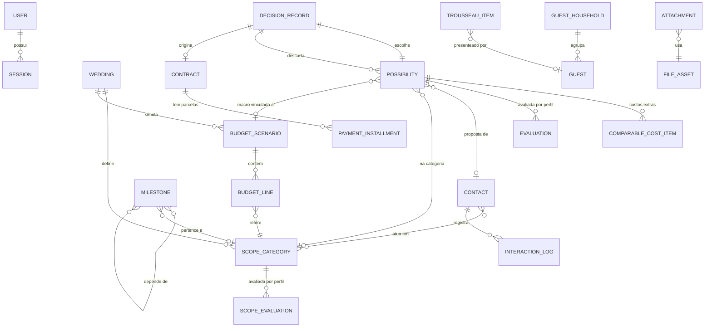

# Arquitetura do Projeto (`docs/engineering/architecture.md`)

> **Status:** **Aprovado pelo usuário em 2026-10-27 (`D-027`)**. Estilo arquitetural (Clean Architecture pragmática), histórico básico e tema escuro em `D-022` (2026-10-26). Mudanças a partir daqui exigem nova decisão registrada.
>
> Complementa `docs/engineering/stack.md` (ferramentas) e **substitui** a seção §3.1 daquele documento (organização de código) e a frase "sem barramento de eventos" (ver §6).

---

## 1. Por que Clean Architecture aqui (resposta à dúvida levantada)

**Vale a pena, mas de forma pragmática e não em todo o sistema com o mesmo rigor.** O motivo decisivo são os **fluxos de agentes (Nível 5)**:

| Necessidade futura | Como a arquitetura ajuda |
| :--- | :--- |
| Agente de IA precisa **propor** mudanças e só aplicá-las após confirmação (`D-005`, `D-008`) | O agente é **mais um adaptador de entrada** que chama os **mesmos casos de uso** da API HTTP, com um `Actor` do tipo agente. A confirmação humana vira conceito da camada de aplicação (`ChangeProposal`), não um remendo. |
| Revisor Geral e notificações **somente-leitura** (`D-008`) | O agente recebe apenas **portas de consulta**, sem `UnitOfWork`. Mutar dados fica **impossível por construção**. |
| Trocar provedor de LLM, canal de notificação (In-App, Push, WhatsApp — `D-013`) e storage (disco → S3) | Isso são **portas** (`LLMClient`, `Notifier`, `FileStorage`) com adaptadores intercambiáveis. |
| Testar fluxos complexos sem rede, LLM nem banco | Casos de uso testados com **fakes das portas**, em milissegundos. |

**Onde NÃO vale o rigor total:** cadastros simples (convidados, itens de enxoval, interações de contato) não têm regra de negócio rica. Por isso adotamos **limites pragmáticos** (§3) para não duplicar código à toa.

> **Sobre "Service":** na Clean Architecture não existe camada "Service" separada. O papel dela é dos **Casos de Uso** (aplicação). Regras puras que envolvem várias entidades ficam como **serviços de domínio** (funções puras na camada de domínio).

---

## 2. Camadas e Regra de Dependência

```
          ┌───────────────────────────────────────────────┐
          │  Frameworks & Infraestrutura                  │  SQLAlchemy, argon2, disco/S3, SDKs de LLM, agendador
          │  ┌─────────────────────────────────────────┐  │
          │  │  Adaptadores de Interface               │  │  FastAPI routers/schemas, CLI (Typer), ferramentas de agente
          │  │  ┌───────────────────────────────────┐  │  │
          │  │  │  Aplicação (Casos de Uso)         │  │  │  commands, queries, portas (Protocols), DTOs, Actor
          │  │  │  ┌─────────────────────────────┐  │  │  │
          │  │  │  │  Domínio (Entidades/Regras) │  │  │  │  Python puro: entidades, value objects, regras, erros
          │  │  │  └─────────────────────────────┘  │  │  │
          │  │  └───────────────────────────────────┘  │  │
          │  └─────────────────────────────────────────┘  │
          └───────────────────────────────────────────────┘
        Dependências apontam SEMPRE para dentro.
```

| Camada | Contém | Pode importar | **Não** pode importar |
| :--- | :--- | :--- | :--- |
| **Domínio** | Entidades, *value objects* (`Money`, `Cents`, `Profile`), regras puras, serviços de domínio, erros de domínio, eventos de domínio | Somente biblioteca padrão do Python | Pydantic, SQLAlchemy, FastAPI, qualquer SDK |
| **Aplicação** | Casos de uso (commands/queries), **portas** (`Protocol`), DTOs de entrada/saída, `Actor`, `UnitOfWork`, `ChangeProposal` | Domínio; **Pydantic permitido** (os DTOs de entrada geram o JSON Schema das ferramentas de agente) | SQLAlchemy, FastAPI, SDKs, adaptadores, infraestrutura |
| **Adaptadores** | Routers e schemas HTTP, comandos CLI, ferramentas de agente (futuro), presenters | Aplicação, Domínio | Infraestrutura (só via composição) |
| **Infraestrutura** | Persistência (tabelas, repositórios, UoW), `LocalFileStorage`/`S3FileStorage`, `Argon2Hasher`, clientes de LLM, notificadores, agendador | Aplicação (portas), Domínio | Adaptadores |
| **Composição (`platform/bootstrap`)** | Único lugar que conhece tudo: instancia portas, injeta casos de uso, registra *handlers* de eventos, cria o app FastAPI | Tudo | — |

A regra é **verificada automaticamente** com **`import-linter`** no CI e no `pre-commit` (contratos em §9). Quebrar a regra falha o build.

---

## 3. Limites Pragmáticos (para não virar cerimônia)

1. **Entidades de domínio ricas só onde há regra:** orçamento/simulador, contadores de convidados, custo comparável, decisão, grafo de cronograma, contrato/parcelas. Cadastros simples usam entidades magras (dataclass sem comportamento).
2. **Sem duplicar modelos ORM:** usar **mapeamento imperativo do SQLAlchemy** (`registry.map_imperatively`), ligando as **tabelas** (definidas na infraestrutura) diretamente às **dataclasses do domínio**. O domínio permanece puro e não existe um segundo conjunto de classes ORM. *Plano B, se o mapeamento imperativo trouxer atrito com tipagem:* mapeadores explícitos `to_domain`/`to_row` apenas nos agregados ricos.
3. **Leitura separada de escrita (CQRS leve):**
   - **Comandos** (criar/alterar) passam por entidades e repositórios.
   - **Consultas** (Home, comparador, simulador, quadro de orçamento, Dossiê, listagens) **não** carregam entidades: leem SQL direto e devolvem DTOs de leitura. Evita *joins* artificiais no domínio e simplifica telas densas.
4. **Portas só onde há variação ou E/S externa:** persistência (repositórios + `UnitOfWork`), `FileStorage`, `Clock`, `IdGenerator`, `PasswordHasher`, e (futuro) `LLMClient`, `Notifier`. **Não** criar porta para bibliotecas puras.
5. **Um caso de uso = uma transação** (um `UnitOfWork` por caso de uso).
6. **Injeção de dependência manual** (funções/classes recebendo portas; `Depends` do FastAPI no adaptador). Sem framework de DI.

---

## 4. Estrutura de Pastas

Pacote **por funcionalidade (módulo)**, com as camadas **dentro** de cada módulo:

```
apps/api/src/wedding/
├─ shared_kernel/          Money, Cents, ProfileKind, Actor, erros base, IDs, Clock (porta)
├─ modules/              identity · wedding · guests · schedule · budget · possibilities
│  └─ <modulo>/          vendors · contracts · trousseau · dossier · files
│     ├─ domain/
│     │  └─ entities.py · value_objects.py · rules.py · events.py · errors.py
│     ├─ application/
│     │  ├─ commands/      (um arquivo por caso de uso de escrita)
│     │  ├─ queries/       (um arquivo por consulta; devolve DTOs de leitura)
│     │  ├─ ports.py       (repositórios, serviços externos)
│     │  ├─ dto.py
│     │  └─ public.py      (única superfície que outros módulos podem importar)
│     ├─ adapters/
│     │  ├─ http/          router.py · schemas.py · mappers.py
│     │  ├─ cli.py         (quando houver)
│     │  └─ agent_tools.py (Nível 5)
│     └─ infrastructure/
│        ├─ tables.py · mapping.py · repositories.py · queries_sql.py
│        └─ (adaptadores específicos do módulo)
├─ platform/
│  ├─ bootstrap/           composição, DI, registro de handlers de eventos
│  ├─ db/                  engine, sessão, UnitOfWork, PRAGMAs, convenção de nomes
│  ├─ http/                app factory, middlewares, tratamento de erros, CSRF, sessão
│  ├─ security/            Argon2, sessões server-side
│  ├─ storage/             LocalFileStorage, S3FileStorage
│  ├─ events/              dispatcher em processo
│  └─ config.py            pydantic-settings
├─ main.py                 (ASGI)  ·  cli.py (Typer)
```

**Regra entre módulos:** um módulo só pode importar `application/public.py` e `domain/events.py` de outro módulo. Nunca suas entidades internas, tabelas ou repositórios.

---

## 5. Princípio de Dados: **Derivar, Não Duplicar**

Para eliminar inconsistências entre telas, **só se persiste o que é fato**; o resto é calculado na leitura:

| Valor | Persistido? | Como é obtido |
| :--- | :--- | :--- |
| `Planejado (Teto)` por categoria/cenário | **Sim** (decisão do casal) | `BudgetCategoryLine` |
| `Estimado` | Não | Propostas em análise da categoria + premissas do cenário; itens *per capita* × contagem de convidados |
| `Contratado` | Não | Soma dos valores dos `Contract` ativos da categoria |
| `Realizado (Pago)` | Não | Soma das `PaymentInstallment` com status `Pago` |
| *Total Nominal / Estimado Ponderado / Confirmados* | Não | Consulta sobre `Guest` |
| `Destravado` vs. `Bloqueado` (cronograma) | Não | Calculado pelo grafo de `dependsOn` e status dos predecessores |
| Custo Total Comparável | Não | `Preço Base` + soma de `ComparableCostItem` |
| Indicador de consenso/divergência | Não | Compara as duas avaliações (`D-012`) |

Consequência: a decisão (`DecisionRecord`) **não precisa atualizar** orçamento por cascata; a coluna `Contratado` simplesmente passa a refletir o contrato registrado.

---

## 6. Eventos de Domínio (revisão do que estava em `stack.md` §3.1)

`stack.md` dizia "sem barramento de eventos". Com a Clean Architecture e o futuro de notificações/agentes, adotamos um **dispatcher síncrono em processo**, simples e deliberadamente limitado:

- Agregados registram eventos (`events.py`); o `UnitOfWork` os coleta.
- **Handlers síncronos (mesma transação, antes do commit):** apenas para **consistência de estado** que não pode ser derivada (ex.: `ProposalDecided` → concluir o marco "Fechar Espaço").
- **Handlers pós-commit (melhor esforço):** efeitos colaterais como **notificações** (Nível 5) e *hooks* de auditoria futura.
- Catálogo inicial (cresce com cada bloco): `ProposalDecided`, `ContractRegistered`, `InstallmentPaid`, `EvaluationSubmitted`, `NextStepSet`, `ScenarioActivated`, `ScopeCategoryStatusChanged`.
- Sem *broker*, sem fila externa e sem reprocessamento. Se um dia for necessário (ex.: lembretes agendados), isso vira nova decisão.

---

## 7. Agentes de IA na Arquitetura (Nível 5 — `D-005`, `D-008`, `D-010`, `D-013`)

```
 [Agente / Workflow de IA]  ──(ferramentas = casos de uso)──►  Aplicação  ──►  Domínio
          │                                                      ▲
          └── LLMClient (porta) ◄── adaptador do provedor        └── Actor(kind="agent", on_behalf_of=Noivo|Noiva)
```

1. **Agente = adaptador de entrada.** Suas ferramentas são *wrappers* de casos de uso existentes; o JSON Schema vem dos DTOs Pydantic de entrada.
2. **Mutação sempre via proposta:** o agente nunca executa um comando de escrita diretamente. Ele chama `ProposeChange(use_case, payload)`, que valida o payload, calcula uma **prévia** e persiste um `ChangeProposal` (`pendente` → `aprovada`/`rejeitada`/`expirada`). Só uma sessão **humana** pode chamar `ApproveChangeProposal`, que executa o caso de uso real com o `Actor` humano e registra `proposed_by = agent`. A regra "o aprovador deve ser humano" mora na camada de aplicação.
3. **Somente-leitura por construção:** agentes proativos (Revisor Geral, notificações) recebem um contexto com **portas de consulta apenas**. Sem `UnitOfWork`, não há como gravar.
4. **Entrevista guiada (`D-010`)** produz um `ChangeProposal` composto (escopo + cenário macro + cenário de orçamento) em lote.
5. **Notificações (`D-013`)** passam pela porta `Notifier` com adaptadores *In-App*, *Web Push* e *WhatsApp*, acionados por eventos pós-commit.
6. **Rastreabilidade:** tabela `AgentRun` (entrada, ferramentas chamadas, saída, custo) a ser criada no Nível 5.
7. **Canais conversacionais (`D-042`)** (módulo de chat, ícone flutuante e WhatsApp) são adaptadores de entrada finos sobre o mesmo servidor de *tools*; o canal só traduz a mensagem e entrega a resposta, sem regra de negócio. No WhatsApp, o número é vinculado a um usuário e a confirmação de uma `ChangeProposal` exige resposta humana explícita.
8. **Escolha de biblioteca de orquestração** (própria, LangGraph, etc.) permanece adiada para o Bloco 5.1; a arquitetura não depende dela.

---

## 8. Convenções de API e de Erros

| Tema | Convenção |
| :--- | :--- |
| Prefixo e versão | `/api/v1`; JSON; `operationId` estável por rota (alimenta o cliente TypeScript) |
| IDs | UUID em string |
| Dinheiro | Inteiro em centavos, campos com sufixo `_cents` (ex.: `base_price_cents`) |
| Datas | `DATE` em ISO (`2026-10-26`); instantes em ISO-8601 UTC |
| Verbos de domínio | Recursos REST para CRUD e **ações como sub-recursos**: `POST /possibilities/{id}/decide`, `POST /installments/{id}/pay`, `POST /budget-scenarios/{id}/activate` |
| Paginação | `limit`/`offset` (volume pequeno); sem cursores |
| Concorrência | **Bloqueio otimista** com coluna `version` (`version_id_col` no SQLAlchemy); conflito → `409` com `code: "version_conflict"` |
| Erros | `application/problem+json` (RFC 9457) com `code` estável de máquina e `detail` em pt-BR; nunca vazar *stack trace* nem detalhes internos |
| Mapeamento | `NotFound`→404 · `Forbidden`→403 · `DomainRuleViolated`→422 · `Conflict`/`VersionConflict`→409 · validação Pydantic→422 · não autenticado→401 |
| Autenticação | Cookie de sessão `HttpOnly` + header customizado anti-CSRF em métodos mutadores |
| Uploads/Downloads | `POST /files` (multipart) e `GET /files/{id}` autenticado com `Content-Disposition`; hash SHA-256 |

---

## 9. Qualidade Arquitetural (Verificada por Máquina)

**Contratos `import-linter`:**
1. *Domínio puro:* `…domain` não importa nada fora da biblioteca padrão e do `shared_kernel`.
2. *Aplicação isolada:* `…application` não importa `…adapters`, `…infrastructure` nem `platform`.
3. *Adaptadores não conhecem infraestrutura:* `…adapters` não importa `…infrastructure`.
4. *Infraestrutura não conhece adaptadores.*
5. *Módulos independentes:* um módulo só importa de outro `application.public` ou `domain.events`.
6. *Só `platform/bootstrap` importa todas as camadas.*

**Pirâmide de testes por camada:**

| Camada | Tipo de teste | Ferramentas |
| :--- | :--- | :--- |
| Domínio | Unitário puro + propriedades (invariantes numéricas de orçamento, contadores, parcelas) | pytest, Hypothesis |
| Aplicação | Casos de uso com **fakes das portas** (sem banco, sem rede) | pytest |
| Infraestrutura | Integração com SQLite real: repositórios, mapeamento, migrações Alembic (subir, descer, subir) | pytest |
| Adaptadores HTTP | `TestClient` com a aplicação composta e SQLite temporário; *snapshot* do OpenAPI | pytest, httpx2 |
| Ponta a ponta | Fluxos críticos em *desktop* e *mobile* (`axe` automatizado adiado em `D-028`) | Playwright |
| Portabilidade | Suíte de integração também contra PostgreSQL antes do primeiro deploy (`stack.md` §4) | Docker/testcontainers |

**Frontend:** limites entre `features` verificados pelo gate de limites (`apps/web/src/architecture.test.ts`, `D-051`), que substitui o `dependency-cruiser` (ver §11).

---

## 10. Persistência: Histórico Básico e Exclusão Lógica (`D-022`)

Todo registro persistente herda um *mixin* padrão:

| Coluna | Uso |
| :--- | :--- |
| `id` (UUID) | Chave primária |
| `created_at` / `updated_at` | Instantes UTC |
| `created_by` / `updated_by` | `user_id` da **sessão** (ou o aprovador humano, quando a proposta veio de agente; o agente fica em `proposed_by` quando aplicável) |
| `deleted_at` / `deleted_by` | Exclusão lógica |
| `version` | Bloqueio otimista |

- Repositórios **filtram `deleted_at IS NULL` por padrão**; restaurar é um caso de uso explícito.
- Unicidade com exclusão lógica via **índices únicos parciais** (`WHERE deleted_at IS NULL`), suportados em SQLite e PostgreSQL.
- Arquivos excluídos mantêm o *blob* até um comando administrativo de purga.
- **Fora de escopo agora:** trilha completa de auditoria com valores anterior/novo (opção "Completo" rejeitada em `D-022`; pode ser adicionada depois via eventos pós-commit, sem alterar os agregados).

---

## 11. Arquitetura do Frontend (`apps/web`)

```
apps/web/src/
├─ app/            providers (Query, Router, Theme), guarda de autenticação, boundaries de erro
├─ routes/         arquivos de rota finos (TanStack Router) → apenas montam páginas das features
├─ features/<modulo>/
│  ├─ api/         chamadas tipadas + chaves de query (key factories)
│  ├─ components/  componentes específicos da feature
│  ├─ hooks/       lógica de tela
│  ├─ schemas/     validação de formulários (Zod)
│  ├─ pages/       composição das telas
│  └─ index.ts     API pública da feature
├─ components/
│  ├─ ui/          primitivos do Design System, incluindo Money (sem conhecimento de API/domínio)
│  └─ domain/      componentes compartilhados com semântica do produto (ProfileChip, RatingPair…), criados no bloco que os usa (D-028)
├─ lib/            cliente OpenAPI, formatação pt-BR, utilitários de acessibilidade
├─ styles/         tokens.css, base, impressão
└─ test/           utilitários e *mocks*
```

**Regras:**
1. `components/ui` **não importa** de `features` nem de `lib/api`.
2. Uma feature só importa outra por seu `index.ts`.
3. **Estado do servidor** = TanStack Query. **Estado de filtros/seleção navegável** = URL (search params tipados). **Estado local de UI** = `useState`. Nenhuma *store* global no início (Zustand só se surgir necessidade comprovada).
4. Formulários: React Hook Form + Zod, mapeando erros `422` do backend para campos.
5. Atualização otimista **apenas** para ações de baixo risco (marcar tarefa, mudar status); o resto invalida a query.
6. Rotas protegidas por `beforeLoad` (sessão); erro de rede/`401` redireciona ao login preservando o destino.
7. Tema aplicado por atributo `data-theme` no `<html>` (ver `docs/design/design-system.md` §3). No Nível 0, fixo em `light` (`D-028`).

---

## 12. Mapa do Domínio (alvo da v1; modelagem **incremental** por bloco)

> `Profile` (`Noivo`/`Noiva`/`Ambos`) é um **enum de domínio**, não uma tabela: `User.profile ∈ {Noivo, Noiva}` e `Ambos` só aparece como responsável/visão. (Ajuste em relação ao Bloco 0.1 de `stack.md` §11, que citava uma tabela `Profile`.)



`ATTACHMENT` é a associação polimórfica (`owner_type`, `owner_id`) de arquivos a propostas, contatos, contratos e parcelas.

### Máquinas de estado (a validar nos respectivos blocos)

| Entidade | Estados e transições principais |
| :--- | :--- |
| `ScopeCategory` | `Em discussão` ⇄ `Entra` / `Talvez` / `Fica de fora` (este exige motivo) |
| `Guest` | `Rascunho` → `Convidado` → `Confirmado` \| `Não irá` |
| `Milestone` | `Bloqueado` → `Destravado` (derivado) → `Em andamento` → `Concluído` |
| `Contact` (funil, só tipo Fornecedor) | `Para contatar` → `Aguardando orçamento` → `Orçamento recebido` → `Em negociação / Visita` → `Contratado` \| `Descartado` (transição livre; `Contratado` derivado a partir do Bloco 3.2; `D-034`) |
| `Possibility` | `Em análise` → `Escolhida` \| `Descartada` (via `DecisionRecord`, com motivos) |
| `BudgetScenario` | `Rascunho/Simulação` ⇄ `Oficial/Ativo` (**exatamente um** ativo, garantido por índice único parcial) |
| `Contract` | `Aguardando assinatura` → `Assinado` \| `Cancelado` (`Quitado` é selo derivado; `D-036`) |
| `PaymentInstallment` | `Pendente` ⇄ `Pago` (com valor pago, comprovante e pagador; `Atrasada` é derivado; `D-036`) |
| `ChangeProposal` (Nível 5) | `Pendente` → `Aprovada` \| `Rejeitada` \| `Expirada` |

---

## 13. Quando Cada Parte Entra (alinhado ao roadmap)

| Nível/Bloco | Arquitetura entregue |
| :--- | :--- |
| **0.1** | `shared_kernel`, `platform/*`, módulos `identity` e `files` completos nas 4 camadas, `UnitOfWork`, dispatcher de eventos (vazio), `import-linter`, gate de limites do frontend, mixin de histórico básico, erros `problem+json`, bloqueio otimista |
| **1.x** | Módulos `wedding`, `guests`, `schedule` (primeiros agregados ricos e consultas) |
| **2.x** | `budget` (simulador e derivação), `possibilities` nível macro |
| **3.x** | `vendors`, `possibilities` nível proposta, `contracts`; primeiro uso real de eventos (`ProposalDecided`) |
| **4.x** | `trousseau`; `dossier` (consultas sobre as outras áreas e **pequena escrita própria**: local do evento, horários-chave, checklist de itens físicos e versões entregues, `D-038`); visão geral e exportação de dados como casos de uso de leitura |
| **5.x** | `agent_tools`, `ChangeProposal`, `LLMClient`, `Notifier`, `AgentRun` |

---

## 14. Riscos e *Trade-offs* Aceitos

| Risco / custo | Mitigação |
| :--- | :--- |
| Mais arquivos e indireção que um CRUD direto | Limites pragmáticos de §3; entidades magras para cadastros; mapeamento imperativo evita modelos duplicados |
| Mapeamento imperativo do SQLAlchemy pode atritar com a tipagem do Pyright | Plano B de mapeadores explícitos só nos agregados ricos |
| Consultas fora do domínio podem vazar regra para SQL | Regra de negócio **numérica** fica em funções puras reutilizadas; consultas apenas projetam/agregam |
| Eventos síncronos podem esconder acoplamento | Catálogo documentado; handlers síncronos restritos a consistência de estado |
| Disciplina de camadas se perde com o tempo | `import-linter` e o gate de limites do frontend no CI e no `pre-commit` |
